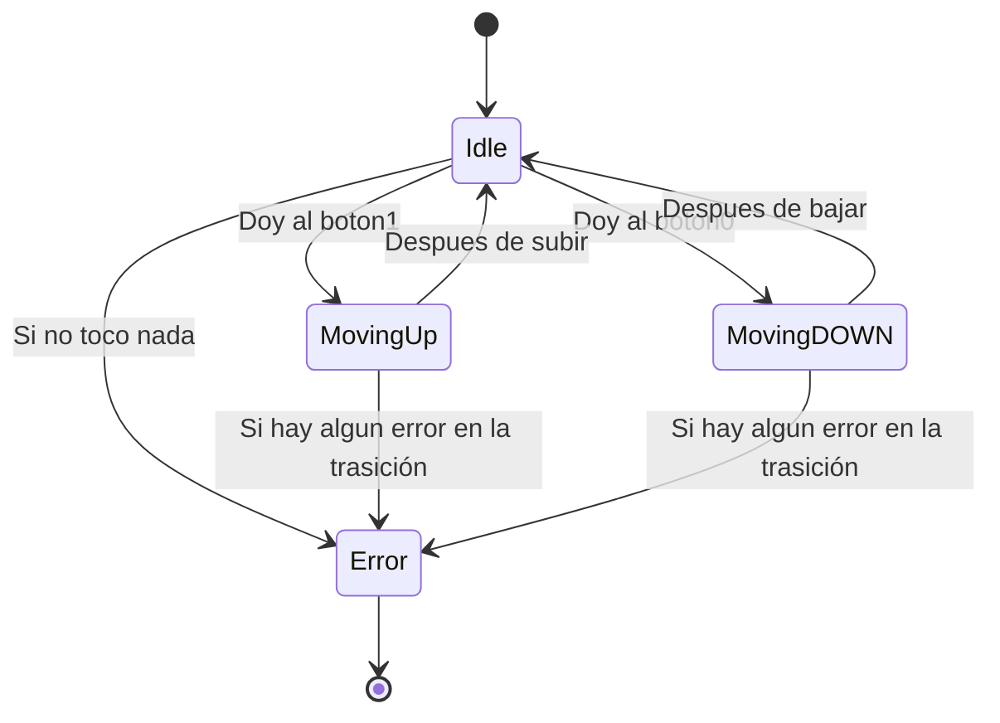

# Resumén

* **`BotoneraInterior`** (`enum`): Define las opciones de piso seleccionables.
    * `Piso0` (Piso 0 - Avenida G. Barbón)
    * `Piso1` (Piso 1 - Plaza de Compostela)
* **`Estados`** (`sealed class`): Define los 4 estados posibles (`Idle`, `MovingUp`, `MovingDOWN`, `Error`) y la lógica ejecutada en `onEnter()`.
* **`Gestor`** (`object`): Mantiene el estado global (`currentState`), evalúa el estado actual y coordina las transiciones.
* **`MainTest`** (`class`): Pruebas unitarias que verifican el correcto comportamiento de la máquina de estados.

---

## Tabla de Estados

| Estado | Tipo | Descripción |
| :--- | :--- | :--- |
| **`Idle`** | Reposo / Inicio | Estado inicial. Evalúa si se interactuó con la botonera y determina el próximo estado (`MovingUp`, `MovingDOWN` o `Error`). |
| **`MovingUp`** | Transición | Simula la subida al **Piso 1**. Si la selección es correcta regresa a `Idle`, de lo contrario conmuta a `Error`. |
| **`MovingDOWN`** | Transición | Simula la bajada al **Piso 0**. Si la selección es correcta regresa a `Idle`, de lo contrario conmuta a `Error`. |
| **`Error`** | Fallo | Estado terminal alcanzado tras interacciones inválidas, valores nulos o ausencia de pulsación (`tocar == false`). |

---

## Tabla de Transiciones

| Estado Origen | Estado Destino | Acción Realizada |
| :--- | :--- | :--- |
| **`Idle`** | **`MovingUp`** | Imprime `"Subiendo"`, pausa de 2s. |
| **`Idle`** | **`MovingDOWN`** | Imprime `"Bajando"`, pausa de 2s. |
| **`Idle`** |  **`Error`** | Imprime mensaje de error/no pulsación. |
| **`MovingUp`** |  **`Idle`** | Imprime `"Preparando Subiendo...."` y espera 2s. |
| **`MovingUp`** | **`Error`** | Conmuta a estado de fallo. |
| **`MovingDOWN`** |  **`Idle`** | Imprime `"Preparando Bajando...."` y espera 2s. |
| **`MovingDOWN`** |  **`Error`** | Conmuta a estado de fallo. |

---

## Diagrama de Estados



# Test
```kotlin
package org.example

import org.example.Estados.Idle
import kotlin.test.AfterTest
import kotlin.test.BeforeTest
import kotlin.test.Test
import kotlin.test.assertEquals

class MainTest {

    @BeforeTest
    fun resetMachineBeforeTest() {
        resetMachine()
    }

    @AfterTest
    fun resetMachineAfterTest() {
        resetMachine()
    }

    @Test
    fun testIdle_MovingUp() {
        Gestor.currentState = Estados.Idle
        Gestor.tocar = true
        Gestor.boton = BotoneraInterior.Piso1
        val siguienteEstado = Gestor.gestorEstados()
        assertEquals(Estados.MovingUp, siguienteEstado)
    }

    @Test
    fun testIdle_Error() {
        Gestor.currentState = Estados.Idle
        Gestor.tocar = true
        Gestor.boton = null
        val siguienteEstado = Gestor.gestorEstados()
        assertEquals(Estados.Error, siguienteEstado)
    }

    @Test
    fun MovingUP_idle() {
        Gestor.currentState = Estados.MovingUp
        Gestor.boton = BotoneraInterior.Piso1
        val siguienteEstado = Gestor.gestorEstados()
        assertEquals(Estados.Idle, siguienteEstado)
    }
    @Test
    fun MovingUP_Error() {
        Gestor.currentState = Estados.MovingUp
        Gestor.boton = null
        val siguienteEstado = Gestor.gestorEstados()
        assertEquals(Estados.Error, siguienteEstado)
    }

    @Test
    fun MovingDOWN_idle() {
        Gestor.currentState = Estados.MovingDOWN
        Gestor.boton = BotoneraInterior.Piso0
        val siguienteEstado = Gestor.gestorEstados()
        assertEquals(Estados.Idle, siguienteEstado)
    }
    @Test
    fun EsMovingDOWN() {
        Gestor.currentState = Estados.MovingDOWN
        Gestor.boton = null
        val siguienteEstado = Gestor.gestorEstados()
        assertEquals(Estados.Error, siguienteEstado)
    }


    private fun resetMachine() {
        Gestor.boton = null
        Gestor.tocar = true
        Gestor.currentState = Idle
    }
}
```
test global pasado:
